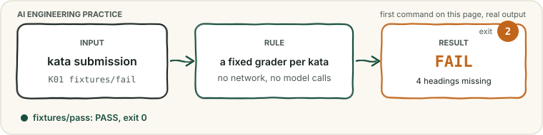

# skill-range

**Anyone can list evaluation, RAG and agent skills on a CV, but a list does not show that the work passes a check.**

[](https://github.com/homayoun-safarpour/ai-eng-skill-range/actions/workflows/ci.yml)


AI engineering practice: 56 skills and 24 katas, each kata with a fixed grader that returns an exit code.

skill-range is a set of 24 exercises (katas) in AI engineering, covering evaluation, retrieval, agent loops and reproducibility, and each kata has its own grader. We built it because a list of skills is easy to copy, and only a fixed grader shows whether a submission meets a stated rule. Given a kata and a folder of submitted files, the grader applies fixed rules, such as required headings, known metric values, file hashes or exit codes, and makes no network or model calls. It prints a PASS or FAIL line and returns exit 0 or 2, so that a reviewer or a CI job can run the same check.

```bash
git clone https://github.com/homayoun-safarpour/ai-eng-skill-range
cd ai-eng-skill-range && pip install -e .
skillrange grade K01 --submission katas/K01-loop-contract/fixtures/fail
```

```text
FAIL: missing headings:
  - ## 2. Verifier
  - ## 3. Stop layers
  - ## 4. State file
  - ## 5. Irreversible
FAIL: K01-loop-contract submission=katas/K01-loop-contract/fixtures/fail
```

That command exits 2. The same kata on `katas/K01-loop-contract/fixtures/pass` exits 0.



[How it works](#how-it-works) · [Results](#what-each-result-means) · [Limits](#limits) · [Interview pack](docs/INTERVIEW.md) · [Cite](#citation) · Part of [a small open stack for checking AI agents and their judges](https://homayoun-safarpour.github.io)

## What each result means

| Output | Exit | Meaning |
|---|---|---|
| `PASS: <kata> submission=<path>` | 0 | Every rule in the kata's grader held for the submitted files. |
| `FAIL: <kata> submission=<path>` | 2 | At least one rule failed. Some graders print the reason first, as K01 does with the missing headings. |
| `FAIL: submission path missing: <path>` | 2 | The `--submission` folder does not exist. |
| `FAIL: grader returned <n>; only 0 or 2 allowed` | 2 | A grader returned another code, and the command counts that as a fail. |

A `PASS` shows that the submission meets the fixed rules of that one grader. It does not show that the work is good beyond those rules: the K01 grader checks that the five headings exist and does not read the text under them, so each kata's `rubric.md` states the rule a person still checks.

## Use this when

| Situation | Use skill-range? |
| --- | --- |
| You want graded practice in evaluation, RAG, agent loop and reproducibility skills | Yes |
| You want a fixed grader with exit `0` or `2` that a person, a CI job or a bot can run | Yes |
| You want a long course that starts from maths | No. Use a full curriculum; this repo is a set of short graded katas |
| You want a runtime agent framework | No. For a loop with state and gates, see [agent-loop-engine](https://github.com/homayoun-safarpour/agent-loop-engine) |
| You want a language model to grade free text | No. The graders use fixed rules only; for judge tools see [judge-field-guide](https://github.com/homayoun-safarpour/judge-field-guide) |

## The problem

A skills list says what someone has studied. It does not show that they can write a hit@k metric that returns the right value, freeze a corpus with a hash, or name the stop conditions of an agent loop. skill-range turns each skill into a small task with a grader that runs offline and needs no API key or GPU.

## How it works

1. `skillrange list` prints the 24 kata ids.
2. Copy a kata's `starter/` folder and fill it in as its `BRIEF.md` describes.
3. `skillrange grade <id> --submission <folder>` loads `katas/<id>/grader/run.py`, calls `grade(submission)`, prints `PASS` or `FAIL` and exits 0 or 2. Without `--submission`, it grades the starter, which fails until it is filled in.

```bash
skillrange list
cp -r katas/K01-loop-contract/starter my-k01
# fill in my-k01/LOOP_CONTRACT.md as BRIEF.md describes
skillrange grade K01 --submission my-k01
skillrange grade K01 --submission katas/K01-loop-contract/fixtures/pass
```

Output of the last command, on the known pass:

```text
PASS: K01-loop-contract submission=katas/K01-loop-contract/fixtures/pass
```

Each kata folder holds the same files, and `tests/test_meta.py` checks that they are all present.

| Path in each kata | What it holds |
|---|---|
| `BRIEF.md` | The task and a "Common fail" note |
| `SKILL.md` | The skill ids from the skill map that the kata covers |
| `rubric.md` | The rule in plain words, including what a person checks |
| `starter/` | The files to fill in |
| `fixtures/pass`, `fixtures/fail` | A known pass and a known fail |
| `grader/run.py` | `grade(submission: Path) -> int`, returning 0 or 2 |

| Module | What it does |
|---|---|
| `skillrange.cli` | The `list` and `grade` commands; finds a kata, loads its grader and keeps the exit code to 0 or 2 |
| `scripts/generate_katas.py` | Writes all 24 katas with their starters, graders, fixtures and briefs |
| `tests/test_meta.py` | Checks the 56 skill ids, the 24 katas, their files, and exit 2 on every `fixtures/fail` and exit 0 on every `fixtures/pass` |

Interview pack: [docs/INTERVIEW.md](docs/INTERVIEW.md), five talking points, each backed by a command. A short walk-through of K01 is in [examples/](examples/), and the claim limits are in [docs/RELIABILITY_CARD.md](docs/RELIABILITY_CARD.md).

## Skill map

- Full map of 56 skills in 7 clusters: [`skills/SKILL_MAP.md`](skills/SKILL_MAP.md)
- Interview-core katas: **K01-K16**
- Specialty katas (evaluation, trust and harness depth): **K17-K24**

All 24 katas in the index are in the repo. We add a new kata only when a skill that employers ask for has no kata yet.

## Limits

- It is not a course or an agent framework. Each kata checks one narrow set of rules, and the skill map and skill tags are chosen by the author rather than measured.
- A pass shows only what the grader checks. For example, K01 passes a `LOOP_CONTRACT.md` that has the five headings with nothing under them.
- The graders of Python katas import and run the submitted code, and K02 runs the submitted `gate.py` as a process, so grade only code you trust.
- Some graders print only the `FAIL` line, without the reason.
- An unknown kata id stops with a Python `FileNotFoundError` and exit 1, which is not a grader verdict.
- It has no runtime dependencies and needs Python 3.10 or later. CI runs the tests on Python 3.10, 3.11 and 3.12. Named tests: `test_golden_pass_and_fail_exit_codes`, `test_skill_map_has_56_ids`, `test_twenty_four_katas_present`, `test_readme_stranger_grade_exits_2`.

## Related tools

- [agent-loop-field-guide](https://github.com/homayoun-safarpour/agent-loop-field-guide): the Loop Contract to write before you automate an agent loop.
- [judge-field-guide](https://github.com/homayoun-safarpour/judge-field-guide): a CI-tested map of tools for language-model judges.

## Citation

Use the "Cite this repository" button on GitHub, which reads [`CITATION.cff`](CITATION.cff).

## Author

Homayoun Safarpour - [LinkedIn](https://www.linkedin.com/in/homayoun-safarpour/)

## License

MIT. See [`LICENSE`](LICENSE).
